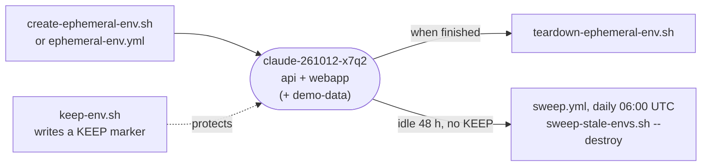

# mootmaker-ephemeral-envs

Scripts and workflows that create, keep, tear down and sweep up **ephemeral environments**: complete,
throwaway copies of the system for development and testing, named `<kind>-<YYMMDD>-<rand4>` (for example
`claude-261012-x7q2`). They deploy several components together, so they live in their own repository rather
than inside any one of them.

How ephemeral environments fit with `test` and `production`, and who creates which kind, is in the hub's
[delivery overview](https://github.com/geoffweatherall/mootmaker/blob/main/docs/overview/delivery.md).

## The scripts

All of them expect the component repositories as sibling checkouts (`../mootmaker-api`,
`../mootmaker-webapp`, `../mootmaker-demo-data`) and AWS credentials for the workload account.

| Script | What it does |
|---|---|
| `create-ephemeral-env.sh [kind] [--with-demo-data] [--keep "<reason>"]` | Generates a name, then runs mootmaker-api's and mootmaker-webapp's own `deploy.sh` into it. `--with-demo-data` also deploys demo-data and seeds the environment once; without it the environment starts empty. Prints the name as the last line of stdout. On failure it prints the name and the teardown command |
| `teardown-ephemeral-env.sh <name> [--yes]` | Finds what is deployed by listing the environment's Terraform state prefix, undeploys each component, and deletes the state objects and any KEEP marker. Prompts per component unless `--yes` |
| `keep-env.sh <name> "<reason>"`, `unkeep-env.sh <name>` | Writes or removes `s3://remote-state-<account>/<name>/KEEP`, which holds the reason, who kept it and when. The sweep skips a kept environment |
| `list-ephemeral-envs.sh` | Read-only report: every environment's state objects, how many resources each tracks, and for live ones whether those resources still exist in AWS |
| `cleanup-stale-envs.sh` | For a person at a keyboard: lists every ephemeral environment and asks about each one before tearing it down |
| `sweep-stale-envs.sh [--destroy] [--max-age-hours N]` | The unattended sweep. Reports only, unless given `--destroy` |

**Names.** `kind` says what created the environment: lowercase letters, digits and hyphens, starting with a
letter, at most 8 characters. The whole name must fit in 22 characters, because AWS resource names are
built from it. Kinds in use:

| Kind | Created by |
|---|---|
| `claude` (the default) | An AI session's own environment, reused for the whole session |
| a person's name | A person's own environment |
| `web-acc` | mootmaker-webapp's `acceptance/run.sh` |
| `and-acc` | mootmaker-android's `run-acceptance` pull request workflow |
| `rel-api`, `rel-web`, `rel-demo`, `rel-and` | Each component's acceptance run inside a release |

**Safety rails.** Teardown refuses any name that does not match `<kind>-<YYMMDD>-<rand4>`, so a typo can
never reach `test` or `production`. Each component's `undeploy.sh` also refuses those two under `--yes`.

## The sweep

`sweep.yml` runs `sweep-stale-envs.sh --destroy` daily at 06:00 UTC. A manual dispatch defaults to
destroying too, and can be unticked for a report-only run. Each report is kept as an artifact for 90 days.
It sweeps four things, reported separately:

1. **Environments with live infrastructure**, stranded by an interrupted run.
2. **Environments whose state is already empty.** `terraform destroy` empties a state file but leaves the
   object, and release builds call `undeploy.sh` directly.
3. **Lambda log groups whose function no longer exists.** Destroying a function leaves the group Lambda
   created.
4. **AppSync log groups whose API no longer exists.** AppSync re-creates these during teardown. They are
   deleted even in report-only mode.

Resources named for an environment with no state at all are reported, never deleted.

The same daily run also runs mootmaker-bootstrap-aws-accounts' `check-accumulation.sh`, which looks for
anything growing with time rather than use, such as log groups without retention. A finding turns the
run red, which is the notification.

An environment is swept only when all of these hold:

- its name matches `<kind>-<YYMMDD>-<rand4>`;
- no `.tflock` object exists under its state prefix, so no Terraform run holds it;
- every object under its state prefix is more than **48 hours** old;
- it has no KEEP marker.

The age guard measures state *writes*, not use. An environment someone is testing in by hand looks idle,
so keep it if it must outlast two days. Kept environments are listed on every run with their reason and
age, so a forgotten keep stays visible.

## From GitHub Actions

`ephemeral-env.yml`, dispatched by hand, runs the same create or teardown scripts on a runner. This is how
a cloud AI session, which has no AWS credentials or Terraform, gets an environment. It can choose the
mootmaker-api and mootmaker-webapp branches to deploy, demo data, and a keep reason. The environment
name, URLs and deployed commits appear in the job summary and as a notice annotation. Pass `request_id` to
find your own run.

Both workflows run as `mootmaker-ephemeral-github-actions-deploy`, an AWS role denied everything belonging
to `test` and `production` (defined in mootmaker-bootstrap-aws-accounts,
`workload-account/github-actions-deploy-role.yaml`). That matters because the workflow deploys whatever
code the chosen branches hold. A create that fails partway is torn down by the same run.

## Cost

An idle ephemeral environment costs almost nothing, because every component scales to zero. Deploying
and testing in it is what costs: a few US cents per acceptance run. See the hub's
[cost overview](https://github.com/geoffweatherall/mootmaker/blob/main/docs/overview/cost-and-scale-to-zero.md).
Problems with an environment, or with the sweep, are covered by the hub's
[ephemeral environment runbook](https://github.com/geoffweatherall/mootmaker/blob/main/docs/runbooks/ephemeral-environment-problems.md)
and [sweep runbook](https://github.com/geoffweatherall/mootmaker/blob/main/docs/runbooks/sweep-failed.md).

How changes here are tested: [testing-strategy.md](testing-strategy.md).
